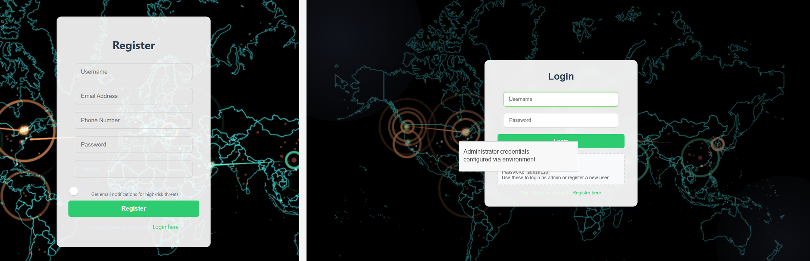
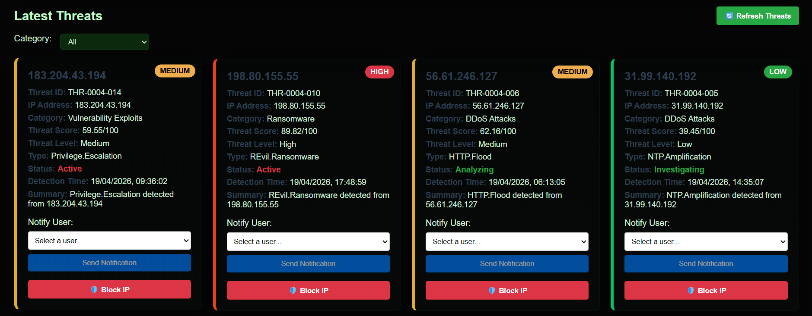
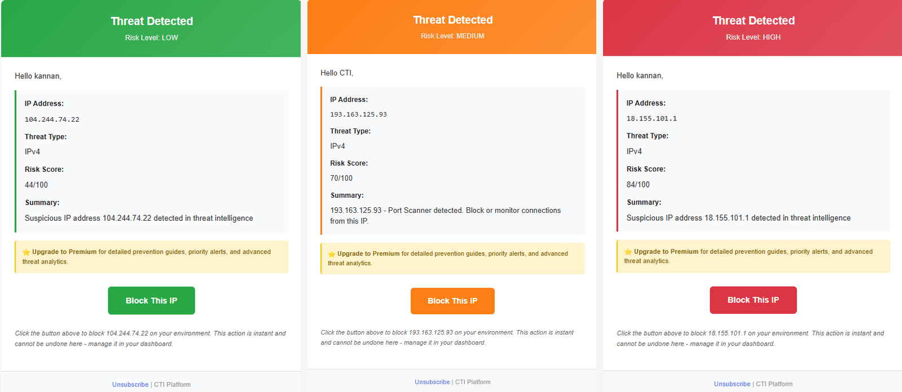
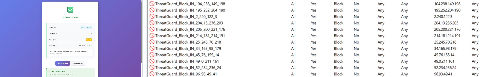
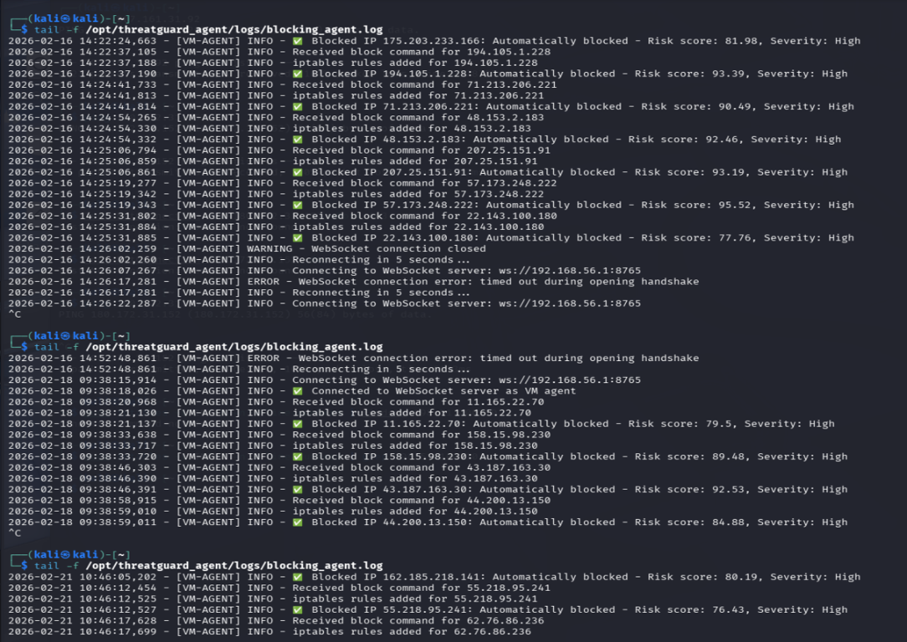
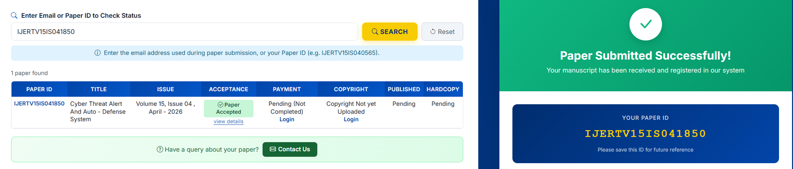

# ThreatGuard

## Cyber Threat Intelligence & Auto-Defense Platform

[](https://github.com/nagulan-d/Cyber-Threat-Intelligence-Auto-Defense-System/actions/workflows/ci.yml)
[](https://www.python.org/)
[](https://react.dev/)

ThreatGuard is a full-stack cyber threat intelligence and automated defense platform. It collects threat indicators, enriches and scores them, presents actionable intelligence in a React dashboard, and can synchronize high-risk IP blocks across a Windows host and a Linux/Kali enforcement agent.

## What the project does

ThreatGuard connects threat intelligence, risk analysis, user notifications, and defensive enforcement in one workflow:

1. Fetch indicators from AlienVault OTX.
2. Validate and normalize indicators.
3. Score threats and classify them by risk and category.
4. Display current intelligence in the React dashboard.
5. Notify subscribed users about high-risk activity.
6. Block malicious IPs on the Windows host.
7. Optionally synchronize blocks with a Linux/Kali VM.
8. Record actions, status, and audit information for administrators.

## Key features

### Threat intelligence

- AlienVault OTX indicator ingestion.
- IP extraction and indicator validation.
- Threat deduplication, categorization, and risk scoring.
- Current, recent, and high-risk threat views.
- Optional Gemini-powered summaries and prevention guidance.

### Defense automation

- Automatic blocking for threats above a configurable risk threshold.
- Windows Firewall inbound and outbound enforcement.
- Linux/Kali VM synchronization through REST and WebSocket services.
- Block and unblock workflows from the administrator dashboard.
- Configurable retry, timeout, and partial-failure behavior.

### Notifications and administration

- Email notifications for high-risk indicators.
- Email action links for subscribed users.
- Admin dashboard for users, alerts, blocks, and action logs.
- Subscription-aware threat detail views.
- JWT-based API authentication and optional security hardening.

### Engineering and operations

- Flask REST API with SQLAlchemy and migrations.
- React single-page application.
- CI checks for Ruff, Black, and the frontend production build.
- Docker Compose support for local containerized development.
- Environment-based configuration with safe example files.

## Screenshots

All project screenshots are stored in the [`screenshot/`](screenshot/) folder.

### Authentication and user experience





### Admin Dashboard




### User Dashboard


### Threat Email Notification



### Automated defense





## Architecture

```text
                         +----------------------+
                         |  AlienVault OTX      |
                         +----------+-----------+
                                    |
                                    v
+----------------+       +----------+-----------+       +------------------+
| React frontend | <----> | Flask threat API     | <---> | SQLite/Postgres  |
| localhost:3000 |  REST | localhost:5000       |       | SQLAlchemy       |
+--------+-------+       +----+----------+-------+       +------------------+
         |                    |          |
         |                    |          +--> Email notifications
         |                    |
         |                    +--> Windows Firewall
         |
         +--------------------------> Admin/user workflows
                                    |
                                    v
                         +----------+-----------+
                         | Linux/Kali VM agent  |
                         | REST + WebSocket     |
                         +----------------------+
```

## Technology stack

| Layer | Technologies |
|---|---|
| Frontend | React 18, React Router, Framer Motion |
| Backend | Python, Flask, Flask-CORS, Flask-Mail |
| Data | SQLAlchemy, Flask-Migrate, SQLite by default |
| Intelligence | AlienVault OTX, optional Gemini integration |
| Enforcement | Windows Firewall, Linux/Kali iptables agent |
| Quality | Ruff, Black, React production build |
| Deployment | Docker, Docker Compose, GitHub Actions |

## Quick start

### Prerequisites

- Python 3.11 or newer
- Node.js 20 or newer and npm
- Windows Administrator access for local firewall enforcement
- Optional: AlienVault OTX API key
- Optional: Gemini API key
- Optional: SMTP app password for email notifications
- Optional: Linux/Kali VM for synchronized enforcement


## Running the platform

### Start the backend

Run PowerShell as Administrator when Windows Firewall enforcement is enabled:

```powershell
cd backend
.\.venv\Scripts\Activate.ps1
python app.py
```

The API is available at `http://127.0.0.1:5000`.

### Start the frontend

In a second terminal:

```powershell
cd frontend
npm start
```

The dashboard is available at `http://localhost:3000`.

### Optional background services

Run these in separate backend terminals when their functionality is enabled:

```powershell
cd backend
python websocket_server.py
python auto_block_monitor.py
```

The repository also includes `backend/start_all_services.ps1` and `backend/START_BACKEND_ADMIN.ps1` for Windows workflows.

### First login

Use the administrator username and password configured through environment variables. Do not use a shared or documented production password.

## Automated IP defense

When auto-blocking is enabled, ThreatGuard:

1. Selects indicators above `AUTO_BLOCK_THRESHOLD`.
2. Validates that the indicator contains a usable IP address.
3. Creates inbound and outbound Windows Firewall rules.
4. Sends the block to the Linux/Kali agent when configured.
5. Records the result and reports partial failures.

For a Kali agent setup, see:

- [Blocking agent guide](readme/BLOCKING_AGENT_GUIDE.md)
- [Deployment guide](readme/DEPLOYMENT_GUIDE.md)
- [IP blocking synchronization guide](readme/IP_BLOCKING_SYNC_IMPLEMENTATION.md)

Useful Kali checks:

```bash
sudo journalctl -u threatguard-agent -f
sudo iptables -S THREATGUARD
sudo iptables -L THREATGUARD -n -v --line-numbers
```

## Docker

From the repository root:

```powershell
docker compose up --build
```

To start only the frontend:

```powershell
docker compose up --build frontend
```


## Project structure

```text
.
├── backend/
│   ├── app.py                         Flask API and application routes
│   ├── models.py                      SQLAlchemy models
│   ├── threat_processor.py            Indicator parsing and validation
│   ├── scorer.py                      Threat risk scoring
│   ├── summarizer.py                  AI summaries and prevention guidance
│   ├── ip_blocker.py                  Windows Firewall enforcement
│   ├── blocking_sync_manager.py      Host/VM synchronization
│   ├── vm_agent/                      Linux/Kali enforcement agent
│   └── migrations/                    Database migrations
├── frontend/
│   ├── src/components/                React views and dashboard components
│   ├── src/config.js                  API configuration
│   └── public/                        Static frontend assets
├── readme/                            Detailed guides and technical notes
├── .github/workflows/ci.yml           Backend and frontend CI
├── docker-compose.yml                 Container orchestration
└── pyproject.toml                     Ruff and Black configuration
```

## Documentation

The [readme/](readme/) directory contains focused guides for:

- [Quick start](readme/QUICK_START.md)
- [Deployment](readme/DEPLOYMENT_GUIDE.md)
- [Admin dashboard](readme/ADMIN_DASHBOARD_AUTO_BLOCKING.md)
- [Auto-blocking](readme/AUTO_BLOCKING_GUIDE.md)
- [Real-time threat ingestion](readme/REALTIME_THREAT_FETCHER.md)
- [Testing](readme/QUICK_START_TESTING.md)
- [System workflow](readme/SYSTEM_WORKFLOW.md)
- [Technical architecture](readme/TECHNICAL_ARCHITECTURE.md)

## IJERT Acceptance

The project paper **Cyber Threat Alert and Auto-Defense System** was accepted by IJERT.


